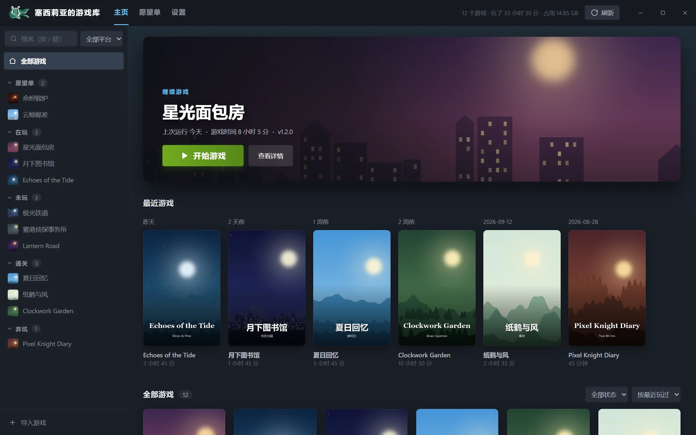
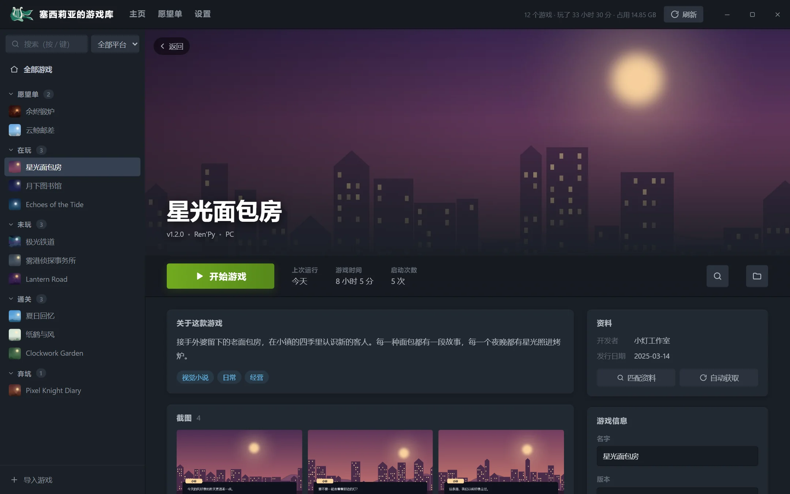
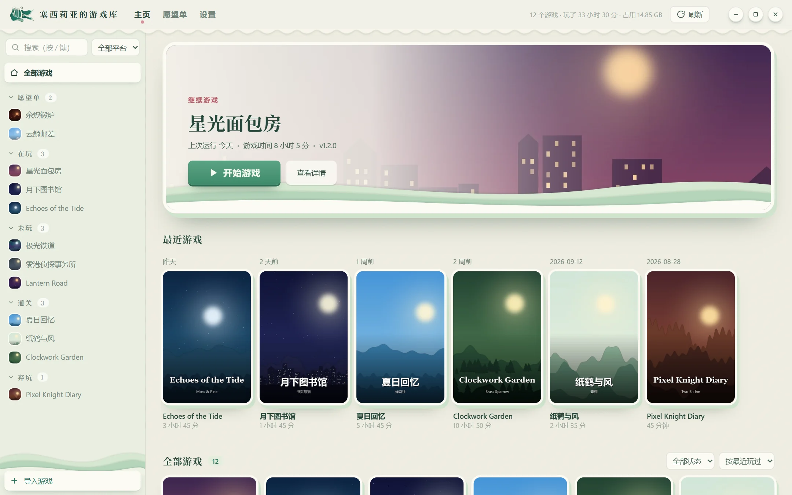
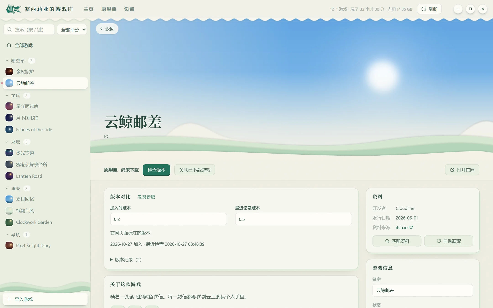

<div align="center">


# 塞西莉亚的游戏库

*Cecilia's Game Library*

**下载完自动解压，解压完自动入库，入库后自动找封面和资料。**<br>
一个仿 Steam 的本地游戏库，配一个会自己干活的解压助手。


[](https://github.com/1606835963aa/cecilia-game-library/releases)
[](LICENSE)

[下载](#download) · [怎么用](#usage) · [常见问题](#faq) · [开源协议](#license)

</div>

---

## ✨ 这是什么

从网盘下载的游戏，往往是带密码的压缩包、分好几卷，有时还套了好几层。下完要一个个解压、整理，玩的时候还得翻文件夹找 exe。

塞西莉亚的游戏库把这些事都接过来：

<table>
<tr>
<td width="50%" valign="top">

### 📦 自动解压

- 下载完自动解压，**还在下的文件不会碰**
- `zip` / `rar` / `7z`、分卷、压缩包套压缩包都能解
- 自动试你存的密码，也会从文件名和说明文字里找密码
- 解完整理好放进游戏文件夹，原压缩包可以自动删掉
- 安卓版 apk 可以单独放、原样留着或直接删掉

</td>
<td width="50%" valign="top">

### 🎮 游戏库

- Steam 风格的界面：封面墙、大横幅、游戏详情页
- 新游戏**自动入库**，自动找封面、简介和截图
- 别处现成的游戏，**拖进窗口就能导入**
- 一键启动，**自动记游玩时长**，按 在玩 / 未玩 / 通关 / 弃坑 分组
- 没下载的游戏先加进**愿望单**，出新版本会提示
- 两套皮肤可换；删游戏进回收站，误删还能找回来

</td>
</tr>
</table>

## 📸 界面

<table>
<tr>
<td width="50%" valign="top">
<br>
<p align="center">主页：继续游戏、最近游戏和封面墙</p>
</td>
<td width="50%" valign="top">
<br>
<p align="center">游戏页面：一键启动、游玩统计、简介和截图</p>
</td>
</tr>
<tr>
<td width="50%" valign="top">
<br>
<p align="center">「浪子的真情」皮肤</p>
</td>
<td width="50%" valign="top">
<br>
<p align="center">愿望单：记下加入时的版本，发现新版会提示</p>
</td>
</tr>
</table>

<a id="download"></a>

## 📥 下载

1. 到 [Releases 页面](https://github.com/1606835963aa/cecilia-game-library/releases) 下载最新的 `塞西莉亚的游戏库-绿色版.zip`。
2. 解压到一个空间够大的地方，比如 `D:\塞西莉亚的游戏库`。以后下载的压缩包和解压好的游戏都放在这个文件夹里。
3. 双击里面的 `塞西莉亚的游戏库.exe` 就能用了。

不用安装，也不用另外装解压软件。整个文件夹拷到别的电脑上，游戏和游玩记录都还在。

> [!TIP]
> 第一次打开时，Windows 可能弹出「Windows 已保护你的电脑」，点「更多信息」→「仍要运行」。Windows 10 打不开窗口的话，装一下 [WebView2 Runtime](https://developer.microsoft.com/microsoft-edge/webview2/)。

解压出来的文件夹：

| 名字 | 是什么 |
| --- | --- |
| `塞西莉亚的游戏库.exe` | 打开游戏库 |
| `自动解压.exe` | 一直盯着下载文件夹，下完马上解压（黑窗口开着就在工作） |
| `downloads` | 下载文件夹，把压缩包下到这里 |
| `games` | 解压好的游戏 |

<a id="usage"></a>

## 🚀 怎么用

### 1. 把下载位置设到 `downloads`

在网盘客户端或浏览器的设置里，把默认下载位置改成游戏库文件夹里的 `downloads`。也可以在游戏库「设置 → 自动解压」里换成你习惯的下载文件夹。

### 2. 下载，然后点「刷新」

游戏下载完后，点游戏库右上角的「刷新」：解压、整理、入库一次做完，新游戏会出现在左边的列表里。

想下完就自动解压，不用每次点刷新：开着 `自动解压.exe` 就行。

> [!TIP]
> 想开机就自动解压：按 `Win + R`，输入 `shell:startup` 回车，把 `自动解压.exe` 的快捷方式拖进打开的文件夹。

### 3. 解压密码

在「设置 → 解压密码」里把常用的密码加进去，解压时会一个个试。没解开的压缩包会留在 `downloads` 里，加上新密码后再点一次「刷新」就行。

### 4. 开始玩

点游戏页面的「开始游戏」，会自动记游玩时长。玩的时候关掉游戏库窗口也没关系，后台会继续计时。

### 更多用法

| 想做的事 | 怎么做 |
| --- | --- |
| 导入别处现成的游戏 | 把游戏文件夹或压缩包拖进窗口，或者点左下角「导入游戏」 |
| 封面、资料不对 | 游戏页面点「匹配资料」搜一下；把商店页面的链接粘进搜索框最准 |
| 换封面或背景 | 游戏页面右边「外观」里换，或者把图片直接拖到页面顶部的大图上 |
| 记下想玩但还没下的游戏 | 顶部「愿望单 → 添加游戏」；以后点「检查版本」看有没有新版，下载后点「关联已下载游戏」 |
| 标记 通关 / 弃坑 | 在游戏上点右键，选「标记为」 |
| 移除和删除 | 「从游戏库移除」只删记录，不动文件；「删除游戏」把游戏文件夹移到回收站 |
| 换皮肤 | 「设置 → 皮肤」，有「经典深色」和「浪子的真情」两套 |
| 搜索 | 按 `/` 跳到搜索框，能搜名字、标签和开发者 |

> [!NOTE]
> 自动找资料时，游戏名会发给 Steam、VNDB、DLsite 和 itch.io 搜索。不想联网，在「设置」里关掉自动找资料，需要时在游戏页面手动点。

<a id="faq"></a>

## ❓ 常见问题

<details>
<summary><b>提示「密码不正确」</b></summary>

把下载页面上写的解压密码加到「设置 → 解压密码」里，再点一次「刷新」。导入时没解开的压缩包，在导入窗口里输密码重试。
</details>

<details>
<summary><b>下载好的文件一直没被解压</b></summary>

- 文件还在下载中的话，会等下完再处理。
- 确认文件下到了 `downloads` 里（放在子文件夹里也行）。
- 分卷压缩包要全部下完、放在同一个文件夹、名字保持原样，缺一个都解不开。
</details>

<details>
<summary><b>杀毒软件报毒 / 被拦截</b></summary>

这是没有花钱买数字签名的小软件常见的误报。如果被删了，在杀毒软件里把游戏库文件夹加进信任列表，再重新解压一次。
</details>

<details>
<summary><b>游戏的主程序认错了</b></summary>

在游戏页面右边「文件」里的「主程序」换一个，手动选过的不会再被改回去。
</details>

<details>
<summary><b>遇到问题想反馈</b></summary>

到 [Issues](https://github.com/1606835963aa/cecilia-game-library/issues) 发一个问题，写清楚做了什么、出了什么错。能附上游戏库文件夹里 `logs` 下的 `game_manager.log` 和 `extract.log` 就更好了。
</details>

<details>
<summary><b>想从源代码运行，或者参与开发</b></summary>

需要 Windows、[Python 3.11](https://www.python.org/downloads/) 和装在默认位置的 [7-Zip](https://www.7-zip.org/)。下载源代码后，在项目文件夹里装依赖：

```bash
pip install cryptography fastapi uvicorn psutil pywin32 Pillow pywebview certifi
```

然后双击 `打开游戏库.bat` 打开游戏库，`启动自动解压.bat` 开始监视下载文件夹。代码结构和开发说明在 [AGENTS.md](AGENTS.md)。
</details>

<a id="license"></a>

## 📄 开源协议

本项目以 [GNU AGPL-3.0](LICENSE) 协议开源：可以自由使用、修改和分发；分发修改后的版本，或者把修改后的版本放到网上给别人用时，要同样以 AGPL-3.0 公开完整源代码。绿色版里自带的 7-Zip 按它自己的许可证（`7-Zip\License.txt`）分发。

---

<p align="center">
  
</p>

<p align="center">感谢claude、deepseek、GPT的辛苦工作，项目才得以诞生，爱你们~♡</p>
