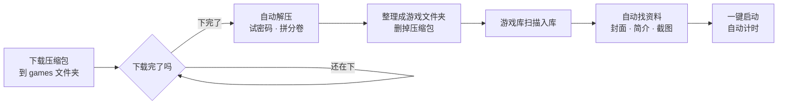

<div align="center">


# 塞西莉亚的游戏库

*Cecilia's Game Library*

**下载完自动解压，解压完自动入库，入库后自动找封面和资料。**<br>
一个仿 Steam 的本地游戏库，配一个会自己干活的解压助手。


[](LICENSE)

[快速开始](#quick-start) · [游戏库](#library) · [自动解压](#extract) · [设置](#settings) · [常见问题](#faq) · [开源协议](#license)

</div>

---

## ✨ 能做什么

<table>
<tr>
<td width="50%" valign="top">

### 📦 自动解压

- 盯着下载文件夹，**等文件下完**再动手
- `zip` / `rar` / `7z`、分卷、自解压分卷、套娃压缩包都能解
- 自动试密码，会从文件夹名、说明 txt 里找线索
- 中文密码的 zip、改了后缀的压缩包也认得
- 安卓版 apk 可以单独放、原样保留或直接删掉
- 解完自动删压缩包，保留原来的文件夹结构

</td>
<td width="50%" valign="top">

### 🎮 游戏库

- Steam 风格界面：封面墙、大横幅、游戏详情页、右键菜单
- 新游戏**自动入库**，认得 Ren'Py、Godot、Unity、RPG Maker 等引擎
- 现成的游戏文件夹、压缩包**拖进窗口就能导入**
- 从游戏文件、Steam、VNDB、DLsite、itch.io **自动找资料**
- 一键启动，**自动计时**，按 在玩 / 未玩 / 通关 / 弃坑 分组
- 独立软件窗口，不是浏览器标签页；两套皮肤可换
- 删游戏进回收站，误删还能找回来

</td>
</tr>
</table>

## 🔄 工作流程



<a id="quick-start"></a>

## 🚀 快速开始

**1. 准备环境**

- Windows 10 / 11（游戏库窗口用 WebView2 显示页面，Windows 11 自带；Windows 10 打不开窗口的话，装一下 [WebView2 Runtime](https://developer.microsoft.com/microsoft-edge/webview2/)）
- [Python 3.11](https://www.python.org/downloads/)，安装时勾选 “Add python.exe to PATH”
- [7-Zip](https://www.7-zip.org/)，装在默认位置 `C:\Program Files\7-Zip\`

**2. 下载项目，装依赖**

在项目的 GitHub 页面点 `Code` → `Download ZIP` 下载解压（会用 git 的话直接 `git clone`），然后在项目文件夹里打开命令行，装 Python 模块：

```bash
pip install cryptography fastapi uvicorn psutil pywin32 Pillow pywebview certifi
```

**3. 双击运行**

| 双击 | 作用 |
| --- | --- |
| `启动自动解压.bat` | 常驻监视 `games` 文件夹，有新压缩包就解压（黑窗口别关，关了就停） |
| `打开游戏库.bat` | 打开游戏库窗口 |
| `扫描一次.bat` | 把现有的压缩包处理一遍就退出 |
| `修改设置.bat` | 用记事本打开 `config.json` |

把下载的游戏存进项目里的 `games` 文件夹（子文件夹也行），剩下的交给它。

> [!TIP]
> 想开机自动解压：按 `Win + R` 输入 `shell:startup` 回车，把 `启动自动解压.bat` 的快捷方式拖进打开的文件夹。

---

<a id="library"></a>

## 🎮 游戏库

双击 `打开游戏库.bat` 打开。它是一个独立的软件窗口，没有地址栏、浏览器账号和黑窗口；窗口大小会记住。没有系统标题栏，顶部导航条就是标题栏：拖空白处移动窗口，双击最大化，拖到屏幕边上分屏，右上角的最小化、最大化、关闭按钮跟着皮肤换样子。游戏库已经开着时再双击，会把原来的窗口叫到前面，不会开第二个。

### 界面

| 位置 | 内容 |
| --- | --- |
| 左边 | 游戏列表，按 在玩 / 未玩 / 通关 / 弃坑 分组，组名可以点击收起；最下面是「导入游戏」 |
| 主页 | 最上面是最近玩的游戏的大横幅；下面是「最近游戏」和全部游戏的封面墙，可以按状态筛选、换排序 |
| 游戏页面 | 背景大图和 Logo、「开始游戏」、游玩统计、简介、类型标签、截图、游玩记录、备注；右边改名字、版本、状态、评分、标签，换封面、背景和主程序 |
| 右键菜单 | 在列表、封面墙或顶部大图上点右键：开始游戏、查看详情、标记为、管理（匹配资料、换封面和背景、重命名、打开文件夹）、移除、删除 |
| 设置页 | 皮肤、安卓版怎么处理、解压后删不删压缩包、要不要自动联网找资料，改完马上保存 |

| 皮肤 | 样子 |
| --- | --- |
| 经典深色（默认） | 仿 Steam 客户端的深色界面 |
| 浪子的真情 | 奶白纸底配淡绿，剪纸层次和纸张纹理，电脑里装了思源宋体（Noto Serif SC）的话标题用宋体；和塞西莉亚花标志同一套配色 |

换皮肤马上生效，窗口标题栏也跟着变色，下次打开还是这套。

| 快捷键 | 作用 |
| --- | --- |
| `/` | 跳到搜索框（能搜名字、标签、类型和开发者） |
| `Esc` | 从游戏页面回主页 |
| `←` `→` | 看大图时翻页 |

### 自动入库

启动时和之后每分钟，会扫一遍 `config.json` 里 `watch_dirs` 的文件夹（默认是 `games`），新解压好的游戏自己出现。右上角「扫描」会立刻扫一遍，并重新统计每个游戏占用的空间。

<details>
<summary><b>能认出哪些游戏</b></summary>

| 引擎 | 靠什么认 |
| --- | --- |
| Ren'Py | 有 `renpy` 和 `game` 两个文件夹 |
| Godot | 有和 exe 同名的 `.pck` 文件 |
| Unity | 有 `UnityPlayer.dll` |
| RPG Maker MV/MZ | 有 `www\js\rpg_core.js` 或 `js\rmmz_core.js` |
| RPG Maker VX/XP | 有 `.rgss3a` 等资源包，或 `Game.ini` + `Data` 文件夹 |
| Unreal | 有 `Engine` 文件夹 |
| 其他 | 文件夹里有 exe，并且有 dll 或子文件夹 |

`.apk` 文件会作为安卓游戏入库（只能记录和打开所在文件夹，不能在电脑上启动）。

游戏名和版本号从文件夹名拆出来，比如 `SummerMemories-1.5.2-pc` → 名字 `Summer Memories`、版本 `1.5.2`。拆得不对可以在游戏页面的「游戏信息」里直接改。

**主程序**：汉化验证器、卸载程序、崩溃上报、运行库安装器这类 exe 不会被当成主程序。认错了就在游戏页面「文件」里的「主程序」换一个，手动选过的不会被扫描改回去。

**来路不明的文件**：游戏文件夹里除主程序以外的 exe / bat 等可执行文件，会在游戏页面最上面用黄色框列出名字，提醒别随便双击。

</details>

### 手动导入

放在别处的现成游戏，用左下角「导入游戏」选压缩包或游戏文件夹，或者直接把它们拖进窗口（一次拖好几个也行）。导入前会列出认出来的东西，勾选要导入的再点「导入」。

| 拖进来的 | 怎么导入 |
| --- | --- |
| 游戏文件夹 | 按选择**挪进** `games`、**复制一份**进去，或者**留在原处**直接登记（文件不动，以后挪走了会显示找不到） |
| 压缩包 | 解压进 `games`，和自动解压一样会试密码、拼分卷、解套娃包；分卷拖哪一份都行。原压缩包默认留着，可以勾选解压成功后移到回收站 |
| 游戏的 exe | 按它所在的文件夹导入，并把它定为主程序，认不出引擎的游戏也能这样导进来 |
| 装着好几个游戏的文件夹 | 往里找三层，把里面的游戏和压缩包一个个列出来 |
| `.apk` | 放进安卓文件夹，也可以留在原处 |

- 已经在游戏库里的会标出来、不能再导；库里有同名游戏的会提醒，默认不勾选。
- 解压时密码都不对，会在导入窗口里让你输密码重试，试对的密码会记进 `config.json` 的 `passwords`。
- 导入在后台一个个做，左下角显示进度；关掉导入窗口不影响。导入没做完时关掉游戏库窗口，窗口会先藏起来，导入完再退出。
- 导入完的游戏和自动入库的一样，会在后台找资料。

### 自动找资料

新游戏入库后会在后台找资料，这时封面左上角显示「找资料」。按下面的顺序找：

| 顺序 | 来源 | 能拿到什么 |
| :---: | --- | --- |
| 1 | **游戏文件**（不联网） | Godot、RPG Maker、Unity 游戏的真名（文件夹叫 `GAME1234` 也能读出游戏真正的名字）；Ren'Py、Godot、RPG Maker 游戏的主菜单背景和 Logo |
| 2 | **DLsite 作品编号** | 文件夹名（往上最多看三层）或说明 txt 里写着作品编号（RJ、VJ、BJ、RE 开头加 6~8 位数字）时，直接按编号查，最准 |
| 3 | **按名字搜** | 用真名和文件夹名同时搜 Steam、VNDB（视觉小说数据库）、DLsite、itch.io，名字完全对上才套用；几家都对上时按这个顺序选 |

- 套用后会换上名字、竖版封面、背景大图、Logo、简介、开发者、发行日期、类型标签和最多 8 张截图，图片存在 `data\covers`，之后打开不用联网。
- 名字对不上就只用游戏文件里取到的图，免得套错。
- DLsite 和 itch.io 的宣传图是横版的，当背景用；图太小（宽不到 1100 像素）而游戏文件里有更大的主菜单图时，用游戏文件里的。背景图偏小时，页面顶部会把它清晰地摆在右边，后面垫一层模糊放大的同一张图。
- 安卓版 apk 读不了里面的文件，会借用同一个游戏 PC 版的真名和图（文件夹名里的游戏名一样就算同一个游戏）。
- 手动改过的名字、手动换过的封面和背景，找资料时不会被覆盖。

**没匹配上或匹配错了**：在游戏页面点放大镜按钮「匹配资料」，自己搜一下，选中正确的那个。知道游戏在哪儿卖的话，**直接把商店页面链接粘贴进搜索框最准**，支持 Steam、VNDB、DLsite、itch.io 的游戏页面链接，DLsite 的游戏也可以只填作品编号。右边「资料」里的「自动获取」会重新自动找一遍，「清除网上的资料」会去掉网上来的简介、截图和图片。

> [!NOTE]
> 联网找资料时，游戏名会发给 Steam、VNDB、DLsite 和 itch.io。不想自动联网，就在「设置」页关掉自动找资料（或把 `config.json` 里的 `auto_scrape` 改成 `false`），新游戏只从游戏文件里取资料，联网要在游戏页面手动点。

### 封面和背景

游戏页面右边「外观」里可以换封面（竖版，比如 600×900）和背景（横版）；图片直接拖到页面顶部的大图上，就是换背景。「恢复」换回自动找到的图。没有竖版封面的游戏，封面墙上用背景图代替；什么图都没有的，用主程序的图标。

### 计时

从游戏库点「开始游戏」才会计时。游戏文件夹里只要还有程序在运行就算在玩，所以先开启动器、再开游戏本体的情况也能算准。

玩的时候关掉游戏库窗口不影响计时：窗口只是藏起来，后台继续计时，游戏结束、记好时长后自己退出；这期间再双击 `打开游戏库.bat` 会把窗口叫回来。

### 移除和删除

| 操作 | 效果 |
| --- | --- |
| **从游戏库移除** | 只删游戏库里的记录和游玩时长，不删硬盘上的文件。游戏文件夹被删掉后封面会变灰、不能启动，放回原处会自动恢复 |
| **删除游戏** | 把游戏文件夹（安卓版是 apk 文件）移到回收站，同时从游戏库移除，删完留下的空文件夹也会清掉。文件可以去回收站还原，游戏库里的记录找不回来 |

- 游戏文件夹（或 apk）在 `games` 和安卓文件夹里挪了位置，只要名字没变，会自动认回原来那个游戏，资料和游玩时长都还在。
- 只能删 `games` 和安卓文件夹里的游戏；游戏正在运行时不能删；没有回收站的盘（比如网络盘）不会删，要自己去文件夹里删。

---

<a id="extract"></a>

## 📦 自动解压

1. 双击 `启动自动解压.bat`，出现黑窗口就开始监视了。
2. 用网盘客户端或浏览器把游戏下载到 `games` 文件夹（子文件夹也行）。
3. 下载完成后自动解压，原压缩包默认删除。

已经下好的文件想立刻处理：双击 `扫描一次.bat`（它会马上动手，最好等文件下完再点）。停止监视：关掉黑窗口，或在窗口里按 `Ctrl + C`。自动解压每轮都重新读设置，改了不用重启。

### 能处理的压缩包

| 类型 | 例子 |
| --- | --- |
| 普通压缩包，可以带密码 | `zip` / `rar` / `7z` |
| 文件名后面带“删” | `xxx.rar删`、`xxx.apk删`（解出来的文件会自动去掉“删”） |
| 分卷（要放在同一个文件夹） | `xxx.7z.001`、`xxx.part1.rar`、`xxx.z01`、`xxx.r00` |
| 自解压分卷 | `xxx.exe` + `xxx.001.sfxv` + `xxx.002.sfxv`（自动拼接后解压） |
| 改了后缀的压缩包 | 名字叫 `xxx.pdf`、实际是 zip |
| 中文密码的 zip | 国产压缩软件按 GBK 存密码，7-Zip 会误报“密码错误”，程序会自己按 GBK 解密 |
| 压缩包套压缩包 | 最多解 `nested_depth` 层 |

**密码**：先试 `config.json` 里的 `passwords`，再从文件夹名、文件名、说明类 `txt` 的内容里找线索。比如目录里有 `2级解压密码GAME158`，就会拿 `GAME158` 去试。

**解压到哪**：压缩包在哪个文件夹，就解压到同一个位置，保留原来的文件夹结构。压缩包直接放在 `games` 根目录、里面又是多个零散文件时，会建一个和压缩包同名的文件夹装起来。

```
games\SummerMemories\PC\SummerMemories_1.5.2.rar删
  ↓
games\SummerMemories\PC\SummerMemories-1.5.2-pc\游戏文件...
```

### 安卓版

PC 版和安卓版常被放在同一个下载里。遇到安卓版（apk）时，按「设置」页或 `config.json` 里的 `android` 处理：

| 设置 | 效果 |
| --- | --- |
| `keep`（默认） | 照常解压，解出来的 apk 挪进安卓文件夹 |
| `archive` | 只装着安卓版的压缩包不解压，原样挪进安卓文件夹 |
| `delete` | 只装着安卓版的压缩包和 apk 直接删掉，不进回收站 |

- 判断方法：看压缩包里除了说明、广告类小文件，装的是不是全是 apk / xapk / obb。
- 安卓文件夹默认是项目里的 `android`，里面保留原来在 `games` 里的相对位置，比如 `games\SummerMemories\AZ\xxx.apk` 会挪到 `android\SummerMemories\AZ\xxx.apk`。
- PC 版和安卓版混在一个压缩包里时，整个包照常解压，再把里面的 apk 挪走或删掉。

### 命令行用法

```
python auto_extract.py                              常驻监视
python auto_extract.py --once                       扫一遍就退出
python auto_extract.py --file "games\xxx\游戏.rar删"  只处理指定文件
python auto_extract.py --dir D:\下载                临时换个要监视的文件夹
python game_manager.py --browser                    用默认浏览器打开游戏库，运行记录直接显示在命令行
```

---

<a id="settings"></a>

## ⚙️ 设置

常用的几项在游戏库顶部「设置」页里就能改。其余的双击 `修改设置.bat`，在 `config.json` 里只写想改的项，没写的用默认值：

```json
{
  "watch_dirs": ["games"],
  "passwords": ["密码1", "密码2"],
  "delete_archive": true
}
```

<details>
<summary><b>全部配置项</b></summary>

| 配置项 | 含义 |
| --- | --- |
| `watch_dirs` | 监视哪些文件夹，可以写多个；相对路径从项目文件夹算起 |
| `passwords` | 解压密码候选，按顺序逐个试 |
| `seven_zip` | 7z.exe 路径，留空自动找 `C:\Program Files\7-Zip\7z.exe` |
| `delete_archive` | 解压成功后是否删除压缩包；`true` 删除，`false` 保留 |
| `poll_seconds` | 每隔几秒扫描一次文件夹 |
| `stable_seconds` | 文件大小多少秒没变化才算下载完成（防止拿到半截文件） |
| `scan_depth` | 往子文件夹里找几层 |
| `nested_depth` | 压缩包套压缩包最多解几层 |
| `auto_scrape` | 新游戏入库时是否自动联网找资料；`false` 时只从游戏文件里取，联网要在游戏页面手动点 |
| `android` | 安卓版怎么处理：`keep` 解压后放进安卓文件夹 / `archive` 不解压原样挪过去 / `delete` 直接删除 |
| `android_dir` | 安卓文件夹的位置，相对路径从项目文件夹算起，默认 `android` |
| `theme` | 游戏库的皮肤：`steam` 经典深色 / `paper` 浪子的真情 |

改完保存，自动解压下一轮扫描、游戏库下一次扫描就会用上新设置；只有 `seven_zip` 要重启自动解压才生效。

</details>

---

<a id="faq"></a>

## ❓ 常见问题

<details>
<summary><b>提示“密码不正确”</b></summary>

密码不在候选列表里。把下载页面上写的解压密码加到 `config.json` 的 `passwords` 里，保存后重新运行。
</details>

<details>
<summary><b>文件一直没被处理</b></summary>

可能还在下载（带 `.downloading`、`.baiduyun.` 的临时文件不会碰），或者放在没监视的文件夹。确认文件在 `games` 里。
</details>

<details>
<summary><b>分卷只解出来一部分 / 报错缺分卷</b></summary>

所有分卷要放在同一个文件夹、名字保持原样，缺一个都解不开。
</details>

<details>
<summary><b>解压出来的东西是空的</b></summary>

可能包里本身就是空的，或者密码不对导致只解出空文件；看 `logs\extract.log` 里的提示。
</details>

<details>
<summary><b>游戏打不开存档，报 “Permission denied” 或直接闪退</b></summary>

Windows 启动程序时，权限取“当前用户”和“exe 文件标签”里较低的那个。在沙盒工具（比如 Codex）的工作文件夹里解压出来的文件会带“低完整性”标签，移动文件夹时标签也会跟着走；带这个标签的游戏会以低权限运行，写不了 `AppData` 里的存档和设置。

游戏入库时和从游戏库启动前，会检查主程序有没有这个标签，有的话自动把整个游戏文件夹恢复成普通权限。手动修复可以在命令行运行：

```
icacls "游戏文件夹" /reset /T /C /Q
icacls "游戏文件夹" /setintegritylevel M /T /C /Q
```
</details>

<details>
<summary><b>游戏库出问题了，想看运行记录</b></summary>

运行记录写在 `logs\game_manager.log`。也可以在命令行运行 `python game_manager.py --browser`，用默认浏览器打开游戏库，记录直接显示在命令行里。
</details>

---

## 🗂️ 项目结构

<details>
<summary><b>展开看每个文件的作用</b></summary>

| 文件 | 作用 |
| --- | --- |
| `auto_extract.py` | 自动解压主程序 |
| `game_manager.py` | 游戏库主程序：本机小网站 + 软件窗口 + 启动计时 |
| `library.py` | 游戏识别和数据库 |
| `importer.py` | 手动导入：识别拖进来的文件夹和压缩包，挪、复制或解压进游戏库 |
| `window_frame.py` | 自绘标题栏：去掉系统标题栏，保留系统边框的缩放、分屏和阴影 |
| `scraper.py` | 找游戏资料：从游戏文件、Steam、VNDB、DLsite、itch.io 找真名、封面、背景、简介和截图 |
| `web\` | 游戏库的页面（HTML / CSS / JS） |
| `docs\` | 说明文档用的图片 |
| `*.bat` | 双击用的启动脚本 |
| `config.json` | 设置文件（两部分共用，不进版本库） |

程序运行后自己生成、不进版本库的：

| 位置 | 内容 |
| --- | --- |
| `games\` | 下载的游戏和解压结果 |
| `android\` | 安卓版 apk（位置可以在设置里改） |
| `data\library.db` | 游戏库数据：游戏信息、状态、评分、备注、游玩记录 |
| `data\covers\` | 封面、背景大图、Logo、截图和图标 |
| `data\extract_state.json` | 处理过的压缩包，避免重复解压 |
| `data\webview\`、`data\window.json` | 游戏库窗口的页面数据和上次的大小 |
| `logs\` | 解压和游戏库的运行日志 |

</details>

<details>
<summary><b>用到的技术</b></summary>

| 模块 | 用途 |
| --- | --- |
| `fastapi` + `uvicorn` | 游戏库在本机跑的小网站，只监听 `127.0.0.1` |
| `pywebview` | 软件窗口（WebView2） |
| `psutil` | 看游戏进程，算游玩时长 |
| `pywin32` + `Pillow` | 取 exe 图标、移到回收站、处理图片 |
| `certifi` | 联网找资料时校验网站证书 |
| `cryptography` | 解中文密码的 zip |

</details>

---

<a id="license"></a>

## 📄 开源协议

本项目以 [GNU AGPL-3.0](LICENSE) 协议开源：可以自由使用、修改和分发；分发修改后的版本，或者把修改后的版本放到网上给别人用时，要同样以 AGPL-3.0 公开完整源代码。

---

<p align="center">
  
</p>

<p align="center">感谢claude、deepseek、GPT的辛苦工作，项目才得以诞生，爱你们~♡</p>
